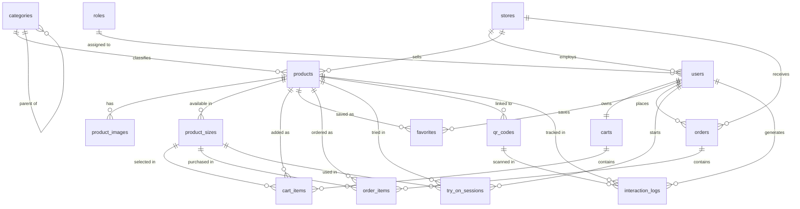

# Database Schema Documentation

**DBMS:** PostgreSQL
**Domain:** E-commerce platform with virtual try-on and QR-code product access

---

## Table of Contents

1. [Overview](#1-overview)
2. [Conventions](#2-conventions)
3. [Entity Relationship Diagram](#3-entity-relationship-diagram)
4. [Table Definitions](#4-table-definitions)
5. [Relationships](#5-relationships)
6. [Design Notes](#6-design-notes)

---

## 1. Overview

The database consists of 15 tables, grouped into five functional domains.

| Domain | Tables | Purpose |
|--------|--------|---------|
| Identity & Access | `roles`, `users` | User accounts and role-based access control |
| Store & Catalog | `stores`, `categories`, `products`, `product_images`, `product_sizes` | Store management, product catalog, media, and size/stock data |
| Shopping | `carts`, `cart_items`, `favorites` | Shopping cart and wishlist |
| Orders | `orders`, `order_items` | Order placement and order line items |
| Virtual Try-On & Analytics | `try_on_sessions`, `qr_codes`, `interaction_logs` | AI try-on sessions, QR code access, and user interaction tracking |

---

## 2. Conventions

**Legend:** PK = Primary Key · FK = Foreign Key · UQ = Unique · NN = Not Null

| Convention | Description |
|------------|-------------|
| Naming | `snake_case` for tables and columns; table names are plural |
| Primary keys | `<entity>_id` of type `serial` (auto-increment) |
| Foreign keys | Same name as the referenced primary key, type `integer` |
| Booleans | `boolean` (e.g., `is_active`, `is_primary`) |
| Timestamps | `timestamp`; `created_at` is set on insert, `updated_at` on modification |
| Monetary values | `numeric(12,2)` |
| Measurements | `numeric(5,1)`, in centimeters or kilograms |

---

## 3. Entity Relationship Diagram

---

## 4. Table Definitions

### 4.1 Identity & Access

#### `roles`
Defines user roles used for authorization.

| Column | Type | Constraints | Description |
|--------|------|-------------|-------------|
| role_id | serial | PK | Unique role identifier |
| name | varchar(50) | NN, UQ | Role name |
| description | varchar(255) | | Role description |
| created_at | timestamp | NN | Creation time |

#### `users`
Stores user accounts, credentials, and body measurements used for size recommendation.

| Column | Type | Constraints | Description |
|--------|------|-------------|-------------|
| user_id | serial | PK | Unique user identifier |
| role_id | integer | NN, FK → `roles.role_id` | Assigned role |
| store_id | integer | FK → `stores.store_id` | Associated store (for store staff) |
| email | varchar(255) | NN, UQ | Login email |
| password_hash | varchar(255) | NN | Hashed password |
| full_name | varchar(150) | NN | Full name |
| phone | varchar(20) | | Phone number |
| height_cm | numeric(5,1) | | Height in centimeters |
| weight_kg | numeric(5,1) | | Weight in kilograms |
| gender | varchar(10) | | Gender |
| is_active | boolean | NN | Account status |
| created_at | timestamp | NN | Creation time |
| updated_at | timestamp | NN | Last update time |

---

### 4.2 Store & Catalog

#### `stores`
Physical or online stores that sell products.

| Column | Type | Constraints | Description |
|--------|------|-------------|-------------|
| store_id | serial | PK | Unique store identifier |
| name | varchar(200) | NN | Store name |
| address | varchar(500) | | Store address |
| phone | varchar(20) | | Contact phone number |
| is_active | boolean | NN | Operating status |
| created_at | timestamp | NN | Creation time |

#### `categories`
Hierarchical product categories (self-referencing).

| Column | Type | Constraints | Description |
|--------|------|-------------|-------------|
| category_id | serial | PK | Unique category identifier |
| name | varchar(100) | NN, UQ | Category name |
| parent_id | integer | FK → `categories.category_id` | Parent category |
| created_at | timestamp | NN | Creation time |

#### `products`
Products offered by stores.

| Column | Type | Constraints | Description |
|--------|------|-------------|-------------|
| product_id | serial | PK | Unique product identifier |
| store_id | integer | NN, FK → `stores.store_id` | Owning store |
| category_id | integer | NN, FK → `categories.category_id` | Product category |
| name | varchar(255) | NN | Product name |
| description | text | | Detailed description |
| price | numeric(12,2) | NN | List price |
| discount_price | numeric(12,2) | | Discounted price |
| color | varchar(50) | | Product color |
| is_active | boolean | NN | Visibility status |
| view_count | integer | NN | Number of views |
| try_on_count | integer | NN | Number of virtual try-ons |
| created_at | timestamp | NN | Creation time |

#### `product_images`
Images associated with a product.

| Column | Type | Constraints | Description |
|--------|------|-------------|-------------|
| image_id | serial | PK | Unique image identifier |
| product_id | integer | NN, FK → `products.product_id` | Parent product |
| image_url | varchar(500) | NN | Image URL |
| image_type | varchar(30) | NN | Image type |
| is_primary | boolean | NN | Marks the primary image |
| sort_order | integer | NN | Display order |

#### `product_sizes`
Available sizes, stock levels, and garment measurements per product.

| Column | Type | Constraints | Description |
|--------|------|-------------|-------------|
| size_id | serial | PK | Unique size identifier |
| product_id | integer | NN, FK → `products.product_id` | Parent product |
| size_label | varchar(20) | NN | Size label (e.g., S, M, L) |
| stock_quantity | integer | NN | Units in stock |
| chest_cm | numeric(5,1) | | Chest measurement (cm) |
| waist_cm | numeric(5,1) | | Waist measurement (cm) |
| length_cm | numeric(5,1) | | Garment length (cm) |

---

### 4.3 Shopping

#### `carts`
One shopping cart per user.

| Column | Type | Constraints | Description |
|--------|------|-------------|-------------|
| cart_id | serial | PK | Unique cart identifier |
| user_id | integer | NN, UQ, FK → `users.user_id` | Cart owner (one-to-one) |
| updated_at | timestamp | NN | Last update time |

#### `cart_items`
Line items in a shopping cart.

| Column | Type | Constraints | Description |
|--------|------|-------------|-------------|
| cart_item_id | serial | PK | Unique cart item identifier |
| cart_id | integer | NN, FK → `carts.cart_id` | Parent cart |
| product_id | integer | NN, FK → `products.product_id` | Product |
| size_id | integer | NN, FK → `product_sizes.size_id` | Selected size |
| quantity | integer | NN | Quantity |

#### `favorites`
Products saved by users to their wishlist.

| Column | Type | Constraints | Description |
|--------|------|-------------|-------------|
| favorite_id | serial | PK | Unique favorite identifier |
| user_id | integer | NN, FK → `users.user_id` | User |
| product_id | integer | NN, FK → `products.product_id` | Saved product |
| created_at | timestamp | NN | Time saved |

---

### 4.4 Orders

#### `orders`
Customer orders placed with a store.

| Column | Type | Constraints | Description |
|--------|------|-------------|-------------|
| order_id | serial | PK | Unique order identifier |
| user_id | integer | NN, FK → `users.user_id` | Customer |
| store_id | integer | NN, FK → `stores.store_id` | Fulfilling store |
| order_code | varchar(50) | NN, UQ | Human-readable order code |
| status | varchar(30) | NN | Order status |
| total_amount | numeric(12,2) | NN | Order total |
| shipping_address | varchar(500) | | Delivery address |
| phone | varchar(20) | | Contact phone for delivery |
| payment_method | varchar(30) | NN | Payment method |
| created_at | timestamp | NN | Order time |

#### `order_items`
Line items belonging to an order.

| Column | Type | Constraints | Description |
|--------|------|-------------|-------------|
| order_item_id | serial | PK | Unique order item identifier |
| order_id | integer | NN, FK → `orders.order_id` | Parent order |
| product_id | integer | NN, FK → `products.product_id` | Product |
| size_id | integer | NN, FK → `product_sizes.size_id` | Purchased size |
| quantity | integer | NN | Quantity |
| unit_price | numeric(12,2) | NN | Unit price at time of purchase |
| subtotal | numeric(12,2) | NN | Line total (`quantity × unit_price`) |

---

### 4.5 Virtual Try-On & Analytics

#### `try_on_sessions`
Records of virtual try-on requests and their results.

| Column | Type | Constraints | Description |
|--------|------|-------------|-------------|
| session_id | serial | PK | Unique session identifier |
| user_id | integer | FK → `users.user_id` | User (nullable for guests) |
| product_id | integer | NN, FK → `products.product_id` | Product being tried on |
| size_id | integer | FK → `product_sizes.size_id` | Selected size |
| user_image_url | varchar(500) | NN | Uploaded user photo |
| result_image_url | varchar(500) | | Generated try-on result |
| status | varchar(30) | NN | Processing status |
| recommended_size | varchar(20) | | Recommended size label |
| processing_time_ms | integer | | Processing duration in milliseconds |
| created_at | timestamp | NN | Session start time |

#### `qr_codes`
QR codes linking physical items to product pages.

| Column | Type | Constraints | Description |
|--------|------|-------------|-------------|
| qr_id | serial | PK | Unique QR code identifier |
| product_id | integer | NN, FK → `products.product_id` | Linked product |
| code_value | varchar(100) | NN, UQ | Encoded QR value |
| qr_image_url | varchar(500) | | QR image URL |
| scan_count | integer | NN | Number of scans |
| is_active | boolean | NN | Activation status |

#### `interaction_logs`
Audit trail of user interactions for analytics.

| Column | Type | Constraints | Description |
|--------|------|-------------|-------------|
| log_id | serial | PK | Unique log identifier |
| user_id | integer | FK → `users.user_id` | User (nullable for guests) |
| product_id | integer | FK → `products.product_id` | Related product |
| qr_id | integer | FK → `qr_codes.qr_id` | Related QR code |
| action_type | varchar(50) | NN | Type of action performed |
| created_at | timestamp | NN | Event time |

---

## 5. Relationships

| Parent Table | Child Table | Foreign Key | Cardinality |
|--------------|-------------|-------------|-------------|
| roles | users | users.role_id | 1 : N |
| stores | users | users.store_id | 1 : N |
| stores | products | products.store_id | 1 : N |
| stores | orders | orders.store_id | 1 : N |
| categories | products | products.category_id | 1 : N |
| categories | categories | categories.parent_id | 1 : N (self-reference) |
| users | carts | carts.user_id | 1 : 1 |
| users | favorites | favorites.user_id | 1 : N |
| users | orders | orders.user_id | 1 : N |
| users | try_on_sessions | try_on_sessions.user_id | 1 : N |
| users | interaction_logs | interaction_logs.user_id | 1 : N |
| products | product_images | product_images.product_id | 1 : N |
| products | product_sizes | product_sizes.product_id | 1 : N |
| products | cart_items | cart_items.product_id | 1 : N |
| products | favorites | favorites.product_id | 1 : N |
| products | order_items | order_items.product_id | 1 : N |
| products | try_on_sessions | try_on_sessions.product_id | 1 : N |
| products | qr_codes | qr_codes.product_id | 1 : N |
| products | interaction_logs | interaction_logs.product_id | 1 : N |
| product_sizes | cart_items | cart_items.size_id | 1 : N |
| product_sizes | order_items | order_items.size_id | 1 : N |
| product_sizes | try_on_sessions | try_on_sessions.size_id | 1 : N |
| carts | cart_items | cart_items.cart_id | 1 : N |
| orders | order_items | order_items.order_id | 1 : N |
| qr_codes | interaction_logs | interaction_logs.qr_id | 1 : N |

---

## 6. Design Notes

- **Role-based access:** Authorization is driven by `users.role_id`. `users.store_id` links store staff to their store and is `NULL` for customers.
- **Category hierarchy:** `categories.parent_id` allows unlimited nesting; top-level categories have a `NULL` parent.
- **Price snapshot:** `order_items.unit_price` stores the price at purchase time, so later changes to `products.price` do not affect order history.
- **Size-aware commerce:** Cart items, order items, and try-on sessions all reference `product_sizes`, so stock and measurements stay consistent across the purchase flow.
- **Guest-friendly analytics:** `try_on_sessions.user_id` and `interaction_logs.user_id` are nullable to support anonymous users who scan a QR code.
- **Suggested indexes:** In addition to primary and unique keys, index the foreign key columns that are queried frequently (e.g., `products.store_id`, `products.category_id`, `order_items.order_id`, `interaction_logs.created_at`).
