# VirtuFit AI - Thiết Kế Cơ Sở Dữ Liệu Toàn Diện (Database Schema & ERD)

**Hệ quản trị CSDL:** PostgreSQL 16 (Async SQLAlchemy 2.0 + asyncpg)  
**Công cụ Migration:** Alembic (`database/migrations`)  
**Phiên bản Schema:** 1.0.0 (2026-10-17)

---

## 1. Sơ Đồ Thực Thể Liên Kết (Entity Relationship Diagram - ERD)

```mermaid
erDiagram
    STORES ||--o{ USERS : "gán nhân viên"
    STORES ||--o{ PRODUCTS : "sở hữu sản phẩm"
    STORES ||--o{ ORDERS : "tiếp nhận đơn hàng"

    CATEGORIES ||--o{ PRODUCTS : "phân loại"
    CATEGORIES ||--o{ CATEGORIES : "danh mục cha - con"
    CATEGORIES ||--o{ DESIGN_REQUESTS : "danh mục thiết kế"

    PRODUCTS ||--o{ PRODUCT_IMAGES : "hình ảnh (gallery)"
    PRODUCTS ||--o{ PRODUCT_SIZES : "kích thước & số đo"
    PRODUCTS ||--o{ CART_ITEMS : "thêm vào giỏ"
    PRODUCTS ||--o{ WISHLIST_ITEMS : "yêu thích"
    PRODUCTS ||--o{ ORDER_ITEMS : "chi tiết dòng đơn"
    PRODUCTS ||--o{ TRYON_JOBS : "thử đồ AI"
    PRODUCTS ||--|| PRODUCT_QR_CODES : "mã QR sản phẩm"

    PRODUCT_SIZES ||--o{ CART_ITEMS : "chọn size"
    PRODUCT_SIZES ||--o{ ORDER_ITEMS : "mua size"

    USERS ||--o{ USER_ADDRESSES : "địa chỉ giao hàng"
    USERS ||--o{ CART_ITEMS : "giỏ hàng"
    USERS ||--o{ WISHLIST_ITEMS : "danh sách thích"
    USERS ||--o{ ORDERS : "đặt hàng (customer)"
    USERS ||--o{ ORDERS : "tạo đơn quầy (sales staff)"
    USERS ||--o{ PAYMENT_TRANSACTIONS : "thu tiền mặt (staff audit)"
    USERS ||--o{ DESIGN_REQUESTS : "yêu cầu thiết kế (customer)"
    USERS ||--o{ DESIGN_REQUESTS : "phụ trách thiết kế (designer)"
    USERS ||--o{ DESIGN_REVISIONS : "trao đổi/góp ý"
    USERS ||--o{ TRYON_JOBS : "lịch sử thử đồ AI"
    USERS ||--o{ CHAT_CONVERSATIONS : "hội thoại (customer/staff)"
    USERS ||--o{ CHAT_MESSAGES : "tin nhắn đã gửi"
    USERS ||--o{ NOTIFICATIONS : "nhận thông báo"

    ORDERS ||--o{ ORDER_ITEMS : "chứa các món hàng"
    ORDERS ||--o{ PAYMENT_TRANSACTIONS : "giao dịch thanh toán"

    DESIGN_REQUESTS ||--o{ DESIGN_CONCEPTS : "AI tạo concept"
    DESIGN_REQUESTS ||--o{ DESIGN_REVISIONS : "lịch sử chỉnh sửa"
    DESIGN_REQUESTS ||--o| ORDERS : "chuyển thành đơn hàng"

    CHAT_CONVERSATIONS ||--o{ CHAT_MESSAGES : "chứa tin nhắn"
```

---

## 2. Danh Sách 20 Bảng Theo 6 Phân Hệ Nghiệp Vụ

| STT | Phân hệ | Tên Bảng | Mục đích |
|---|---|---|---|
| 1 | **Cửa hàng & Danh mục** | `stores` | Quản lý cửa hàng vật lý và kho hàng trung tâm |
| 2 | | `categories` | Phân cấp cây danh mục sản phẩm (cha-con đệ quy) |
| 3 | **Sản phẩm & Media** | `products` | Thông tin chi tiết sản phẩm thời trang |
| 4 | | `product_images` | Gallery ảnh sản phẩm (front, back, detail, model) |
| 5 | | `product_sizes` | Tồn kho theo size & số đo đo may thực tế (ngực, eo, dài) |
| 6 | | `product_qr_codes` | Mã QR định danh sản phẩm phục vụ quét tại shop |
| 7 | **Người dùng & Phân quyền** | `users` | Tài khoản 5 vai trò (Admin, Sales, Warehouse, Designer, Customer) |
| 8 | | `user_addresses` | Địa chỉ giao hàng đã dùng tại bước checkout |
| 9 | **Mua sắm (Shopping)** | `cart_items` | Giỏ hàng lưu DB (chống mất khi đổi thiết bị) |
| 10 | | `wishlist_items` | Danh sách sản phẩm quan tâm/yêu thích |
| 11 | **Đơn hàng & Thanh toán** | `orders` | Đơn hàng Online và Đơn hàng tại quầy (Counter Order) |
| 12 | | `order_items` | Dòng sản phẩm (snapshot giá tại thời điểm chốt đơn) |
| 13 | | `payment_transactions` | Giao dịch VNPay/tiền mặt (Idempotency chống double-pay) |
| 14 | **Thiết kế riêng (Custom)** | `design_requests` | Yêu cầu may đo/thiết kế riêng từ khách hàng |
| 15 | | `design_concepts` | Ảnh mẫu concept do AI sinh ra dựa trên brief |
| 16 | | `design_revisions` | Lịch sử trao đổi, tinh chỉnh giữa Designer và Khách |
| 17 | **AI Virtual Try-On** | `tryon_jobs` | Tác vụ phòng thay đồ ảo (ảnh vào, ảnh ra trên MinIO) |
| 18 | **Tương tác & Chăm sóc** | `chat_conversations` | Phiên trò chuyện tư vấn giữa khách hàng và nhân viên |
| 19 | | `chat_messages` | Từng tin nhắn (phân biệt chatbot AI và nhân viên người thật) |
| 20 | | `notifications` | Thông báo đẩy hệ thống (kèm deep-link tới đơn/thiết kế) |

---

## 3. Đặc Tả Chi Tiết Các Bảng

### 3.1 Nhóm Cửa Hàng & Danh Mục

#### `stores`
- `store_id` (PK, Serial, Int)
- `name` (Varchar 200, Not Null)
- `address` (Varchar 500)
- `phone` (Varchar 20)
- `is_active` (Boolean, Default True)
- `created_at` (Timestamp, Default NOW)

#### `categories`
- `category_id` (PK, Serial, Int)
- `name` (Varchar 100, Unique, Not Null)
- `parent_id` (FK → `categories.category_id`, Nullable, ondelete SET NULL)
- `created_at` (Timestamp, Default NOW)

---

### 3.2 Nhóm Sản Phẩm & Kích Thước

#### `products`
- `product_id` (PK, Serial, Int)
- `store_id` (FK → `stores.store_id`, ondelete CASCADE, Not Null)
- `category_id` (FK → `categories.category_id`, ondelete RESTRICT, Not Null)
- `name` (Varchar 255, Not Null, Index)
- `description` (Text)
- `price` (Numeric 12,2, Not Null)
- `discount_price` (Numeric 12,2, Nullable)
- `color` (Varchar 50, Nullable)
- `is_active` (Boolean, Default True, Index)
- `view_count` (Integer, Default 0)
- `try_on_count` (Integer, Default 0)
- `created_at` (Timestamp, Default NOW, Index)

#### `product_images`
- `image_id` (PK, Serial, Int)
- `product_id` (FK → `products.product_id`, ondelete CASCADE, Not Null)
- `image_url` (Varchar 500, Not Null)
- `image_type` (Varchar 30, Default 'front') — `front`, `back`, `detail`, `model`
- `is_primary` (Boolean, Default False)
- `sort_order` (Integer, Default 0)

#### `product_sizes`
- `size_id` (PK, Serial, Int)
- `product_id` (FK → `products.product_id`, ondelete CASCADE, Not Null)
- `size_label` (Varchar 20, Not Null) — `S`, `M`, `L`, `XL`, `XXL`
- `stock_quantity` (Integer, Default 0, Not Null)
- `chest_cm` (Numeric 5,1, Nullable) — Số đo ngực áo
- `waist_cm` (Numeric 5,1, Nullable) — Số đo eo áo/quần
- `length_cm` (Numeric 5,1, Nullable) — Chiều dài sản phẩm

#### `product_qr_codes`
- `qr_id` (PK, Serial, Int)
- `product_id` (FK → `products.product_id`, Unique, ondelete CASCADE, Not Null)
- `qr_image_url` (Varchar 500, Not Null) — URL ảnh QR lưu trên S3/MinIO
- `qr_data` (Varchar 500, Not Null) — Deep-link URI hoặc mã chuỗi
- `is_active` (Boolean, Default True)
- `created_at` (Timestamp, Default NOW)

---

### 3.3 Nhóm Người Dùng & Phân Quyền (5 Roles)

#### `users`
- `user_id` (PK, Serial, Int)
- `phone` (Varchar 20, Unique, Index, Nullable)
- `email` (Varchar 255, Unique, Index, Nullable)
- `password_hash` (Varchar 255, Nullable — cho phép Google login)
- `full_name` (Varchar 200, Not Null)
- `avatar_url` (Varchar 500, Nullable)
- `gender` (Enum: `male`, `female`, `other`)
- `date_of_birth` (Timestamp, Nullable)
- `role` (Enum: `customer`, `sales_staff`, `warehouse_staff`, `designer`, `admin`, Index, Not Null)
- `google_id` (Varchar 100, Unique, Nullable)
- `is_active` (Boolean, Default True, Index)
- `is_verified` (Boolean, Default False)
- `height_cm` (Integer, Nullable — gợi ý size AI)
- `weight_kg` (Integer, Nullable — gợi ý size AI)
- `created_at` (Timestamp, Default NOW)
- `updated_at` (Timestamp, Default NOW)
- `last_login_at` (Timestamp, Nullable)

#### `user_addresses`
- `address_id` (PK, Serial, Int)
- `user_id` (FK → `users.user_id`, ondelete CASCADE, Not Null)
- `receiver_name` (Varchar 200, Not Null)
- `receiver_phone` (Varchar 20, Not Null)
- `province` (Varchar 100, Not Null)
- `district` (Varchar 100, Not Null)
- `ward` (Varchar 100, Nullable)
- `address_detail` (Varchar 500, Not Null)
- `is_default` (Boolean, Default False)
- `created_at` (Timestamp, Default NOW)

---

### 3.4 Nhóm Mua Sắm & Đơn Hàng

#### `cart_items`
- `cart_item_id` (PK, Serial, Int)
- `user_id` (FK → `users.user_id`, ondelete CASCADE, Not Null, Index)
- `product_id` (FK → `products.product_id`, ondelete CASCADE, Not Null)
- `size_id` (FK → `product_sizes.size_id`, ondelete CASCADE, Not Null)
- `quantity` (Integer, Default 1, Not Null)
- `created_at` (Timestamp, Default NOW)
- `updated_at` (Timestamp, Default NOW)
- **Ràng buộc:** `UniqueConstraint("user_id", "product_id", "size_id")`

#### `wishlist_items`
- `wishlist_item_id` (PK, Serial, Int)
- `user_id` (FK → `users.user_id`, ondelete CASCADE, Not Null, Index)
- `product_id` (FK → `products.product_id`, ondelete CASCADE, Not Null)
- `created_at` (Timestamp, Default NOW)
- **Ràng buộc:** `UniqueConstraint("user_id", "product_id")`

#### `orders`
- `order_id` (PK, Serial, Int)
- `order_code` (Varchar 30, Unique, Index, Not Null) — VD: `VF-20261017-0001`
- `customer_id` (FK → `users.user_id`, ondelete RESTRICT, Nullable — cho phép khách vãng lai mua tại quầy)
- `staff_id` (FK → `users.user_id`, ondelete SET NULL, Nullable — Sales staff tạo đơn quầy)
- `store_id` (FK → `stores.store_id`, ondelete RESTRICT, Nullable)
- `status` (Enum: `pending`, `confirmed`, `processing`, `shipping`, `delivered`, `completed`, `cancelled`, `returned`)
- `payment_status` (Enum: `unpaid`, `pending`, `paid`, `refunded`, `failed`)
- `payment_method` (Enum: `cod`, `vnpay`, `banking`, `cash`, `momo`)
- `shipping_method` (Enum: `standard`, `express`, `store_pickup`)
- `shipping_name` (Varchar 200, Nullable)
- `shipping_phone` (Varchar 20, Nullable)
- `shipping_address` (Varchar 500, Nullable)
- `subtotal` (Numeric 15,2, Not Null, Default 0)
- `shipping_fee` (Numeric 15,2, Not Null, Default 0)
- `discount_amount` (Numeric 15,2, Not Null, Default 0)
- `total_amount` (Numeric 15,2, Not Null, Default 0)
- `is_counter_order` (Boolean, Default False)
- `cash_received` (Numeric 15,2, Nullable)
- `cash_change` (Numeric 15,2, Nullable)
- `design_request_id` (FK → `design_requests.request_id`, ondelete SET NULL, Nullable)
- `note` (Text, Nullable)
- `cancelled_reason` (Text, Nullable)
- `created_at` (Timestamp, Default NOW, Index)
- `updated_at` (Timestamp, Default NOW)
- `confirmed_at` / `shipped_at` / `delivered_at` (Timestamp, Nullable)

#### `order_items`
- `item_id` (PK, Serial, Int)
- `order_id` (FK → `orders.order_id`, ondelete CASCADE, Not Null)
- `product_id` (FK → `products.product_id`, ondelete RESTRICT, Not Null)
- `size_id` (FK → `product_sizes.size_id`, ondelete RESTRICT, Nullable)
- `product_name` (Varchar 255, Not Null) — Snapshot
- `size_label` (Varchar 20, Nullable) — Snapshot
- `color` (Varchar 50, Nullable) — Snapshot
- `unit_price` (Numeric 12,2, Not Null) — Snapshot tại thời điểm chốt đơn
- `quantity` (Integer, Default 1, Not Null)
- `line_total` (Numeric 15,2, Not Null) — Snapshot `unit_price * quantity`
- `product_image_url` (Varchar 500, Nullable) — Snapshot ảnh chính

#### `payment_transactions`
- `transaction_id` (PK, Serial, Int)
- `order_id` (FK → `orders.order_id`, ondelete CASCADE, Not Null)
- `transaction_ref` (Varchar 100, Unique, Index, Nullable) — Mã giao dịch VNPay/ngân hàng (Chống double callback)
- `method` (Enum: `cod`, `vnpay`, `banking`, `cash`, `momo`)
- `status` (Enum: `pending`, `paid`, `refunded`, `failed`)
- `amount` (Numeric 15,2, Not Null)
- `currency` (Varchar 10, Default 'VND')
- `gateway_response` (Text, Nullable) — Raw JSON phản hồi từ cổng thanh toán
- `bank_code` (Varchar 20, Nullable)
- `card_type` (Varchar 20, Nullable)
- `staff_id` (FK → `users.user_id`, ondelete SET NULL, Nullable) — Kiểm toán tiền mặt
- `staff_note` (Text, Nullable)
- `created_at` (Timestamp, Default NOW)
- `completed_at` (Timestamp, Nullable)

---

### 3.5 Nhóm Thiết Kế Riêng & AI Virtual Try-On

#### `design_requests`
- `request_id` (PK, Serial, Int)
- `request_code` (Varchar 30, Unique, Index, Not Null) — VD: `DR-20261017-0001`
- `customer_id` (FK → `users.user_id`, ondelete RESTRICT, Not Null)
- `designer_id` (FK → `users.user_id`, ondelete SET NULL, Nullable)
- `status` (Enum: `submitted`, `ai_generating`, `concept_ready`, `reviewing`, `quoted`, `approved`, `in_production`, `completed`, `cancelled`, `rejected`)
- `title` (Varchar 255, Not Null)
- `description` (Text, Nullable)
- `reference_images` (Text, Nullable — JSON array object keys trên S3)
- `category_id` (FK → `categories.category_id`, ondelete SET NULL, Nullable)
- `preferred_color` / `preferred_size` (Varchar)
- `budget_min` / `budget_max` (Numeric 15,2)
- `quoted_price` (Numeric 15,2, Nullable)
- `estimated_days` (Integer, Nullable)
- `designer_note` (Text, Nullable)
- `rejection_reason` (Text, Nullable)
- `created_at` / `updated_at` / `quoted_at` / `approved_at` (Timestamp)

#### `design_concepts`
- `concept_id` (PK, Serial, Int)
- `request_id` (FK → `design_requests.request_id`, ondelete CASCADE, Not Null)
- `image_url` (Varchar 500, Not Null — object key bucket private)
- `prompt_used` (Text, Nullable)
- `ai_provider` (Varchar 50, Nullable)
- `is_selected` (Integer, Default 0)
- `created_at` (Timestamp, Default NOW)

#### `design_revisions`
- `revision_id` (PK, Serial, Int)
- `request_id` (FK → `design_requests.request_id`, ondelete CASCADE, Not Null)
- `author_id` (FK → `users.user_id`, ondelete SET NULL, Nullable)
- `content` (Text, Not Null)
- `image_url` (Varchar 500, Nullable)
- `revision_number` (Integer, Default 1)
- `created_at` (Timestamp, Default NOW)

#### `tryon_jobs`
- `job_id` (PK, Serial, Int)
- `user_id` (FK → `users.user_id`, ondelete CASCADE, Not Null, Index)
- `product_id` (FK → `products.product_id`, ondelete SET NULL, Nullable)
- `status` (Enum: `pending`, `processing`, `completed`, `failed`)
- `input_image_key` (Varchar 500, Not Null — MinIO private bucket)
- `product_image_key` (Varchar 500, Nullable)
- `result_image_key` (Varchar 500, Nullable — MinIO private bucket)
- `ai_provider` (Varchar 50, Nullable)
- `error_message` (Text, Nullable)
- `processing_time_ms` (Integer, Nullable)
- `created_at` (Timestamp, Default NOW, Index)
- `completed_at` (Timestamp, Nullable)

---

### 3.6 Nhóm Tương Tác: Chat & Thông Báo

#### `chat_conversations`
- `conversation_id` (PK, Serial, Int)
- `customer_id` (FK → `users.user_id`, ondelete CASCADE, Not Null, Index)
- `staff_id` (FK → `users.user_id`, ondelete SET NULL, Nullable)
- `subject` (Varchar 255, Nullable)
- `is_active` (Boolean, Default True)
- `order_id` (FK → `orders.order_id`, ondelete SET NULL, Nullable)
- `design_request_id` (FK → `design_requests.request_id`, ondelete SET NULL, Nullable)
- `created_at` / `updated_at` (Timestamp, Default NOW)

#### `chat_messages`
- `message_id` (PK, Serial, Int)
- `conversation_id` (FK → `chat_conversations.conversation_id`, ondelete CASCADE, Not Null, Index)
- `sender_id` (FK → `users.user_id`, ondelete SET NULL, Nullable — NULL tương đương AI Bot / System)
- `message_type` (Enum: `text`, `image`, `product_link`, `system`)
- `content` (Text, Not Null)
- `image_url` (Varchar 500, Nullable)
- `is_read` (Boolean, Default False)
- `created_at` (Timestamp, Default NOW, Index)

#### `notifications`
- `notification_id` (PK, Serial, Int)
- `user_id` (FK → `users.user_id`, ondelete CASCADE, Not Null, Index)
- `type` (Enum: `order`, `promotion`, `design`, `tryon`, `system`)
- `title` (Varchar 255, Not Null)
- `content` (Text, Nullable)
- `is_read` (Boolean, Default False, Index)
- `reference_type` (Varchar 50, Nullable — `order`, `design_request`, `tryon_job`)
- `reference_id` (Integer, Nullable — ID để deep-link trực tiếp trên app)
- `created_at` (Timestamp, Default NOW, Index)

---

## 4. Các Quy Tắc Nghiệp Vụ Bắt Buộc (Business Rules Enforcement)

1. **Snapshot Giá Cố Định (Price Snapshots):** Khi tạo đơn hàng, bảng `order_items` lưu cố định `unit_price` và `line_total`. Tổng tiền hàng `subtotal` và `total_amount` được tính lại hoàn toàn ở backend bằng cách query giá thực tế từ DB, tuyệt đối không tin giá client gửi lên.
2. **Chống Thanh Toán Lặp (Payment Idempotency):** Cột `payment_transactions.transaction_ref` có ràng buộc Unique. Bất kỳ callback lặp lại nào từ VNPay hoặc nhân viên nhập lại sẽ bị từ chối hoặc xử lý an toàn.
3. **Giỏ Hàng Nhất Quán (Unique Cart Item):** `(user_id, product_id, size_id)` là duy nhất trên `cart_items`. Thêm cùng sản phẩm sẽ tăng `quantity` thay vì sinh dòng mới.
4. **Phân Quyền 5 Vai Trò:**
   - `customer`: Xem catalog, thêm giỏ hàng, đặt hàng online, gửi brief thiết kế, dùng AI try-on, xem lịch sử của chính mình.
   - `sales_staff`: Xem catalog, tạo đơn hàng tại quầy (counter order), xác nhận thanh toán tiền mặt, chat tư vấn với khách.
   - `warehouse_staff`: Xem tồn kho theo size (`product_sizes`), cập nhật số lượng nhập kho, chuyển trạng thái đơn sang shipping.
   - `designer`: Xem các yêu cầu thiết kế `design_requests`, tạo AI concepts, trao đổi revisions, gửi báo giá cho khách.
   - `admin`: Toàn quyền hệ thống, cấp tài khoản nhân viên, cấu hình tham số, xem thống kê doanh thu và phân tích.
